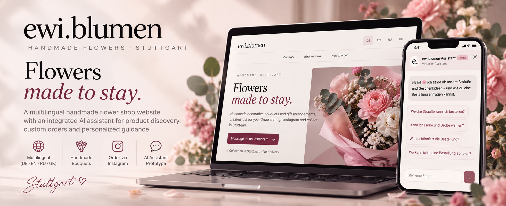
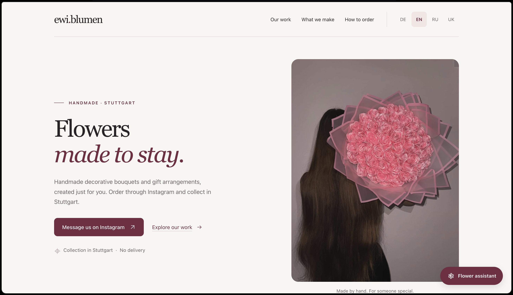
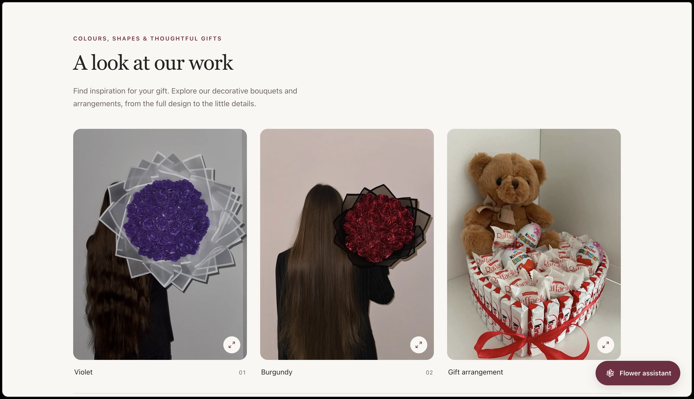
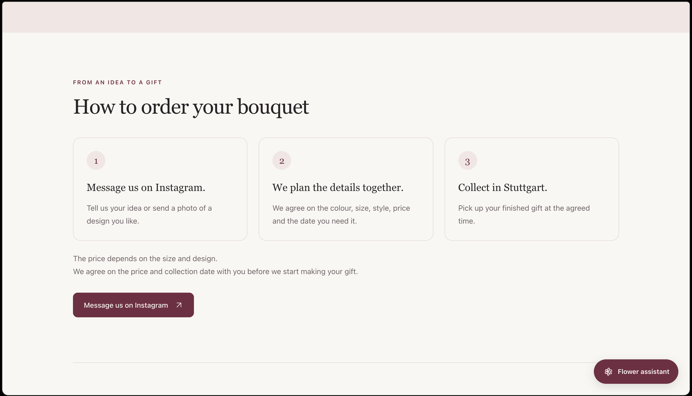
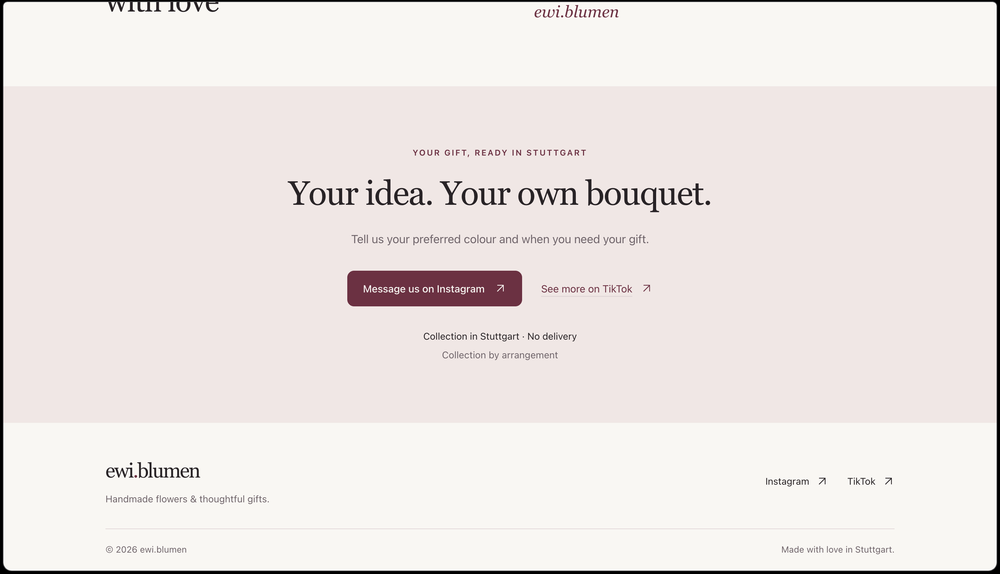
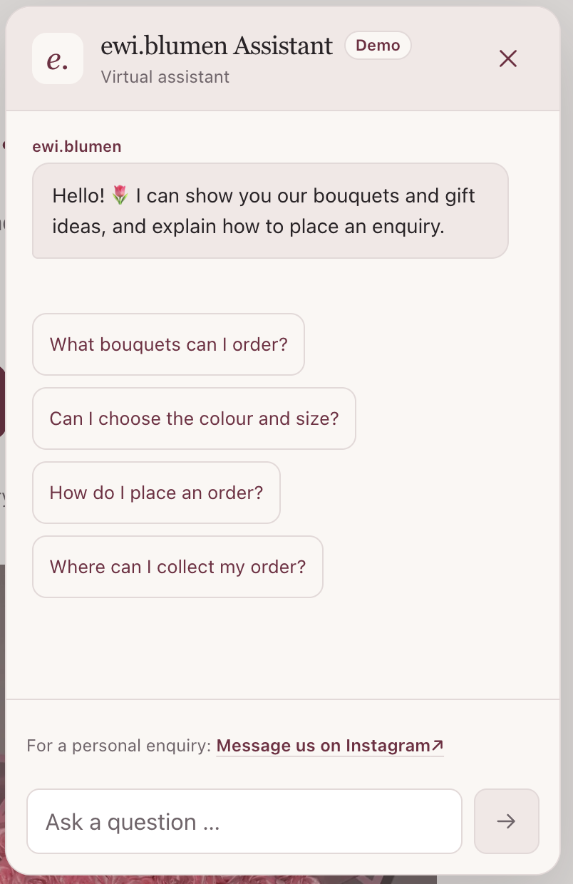
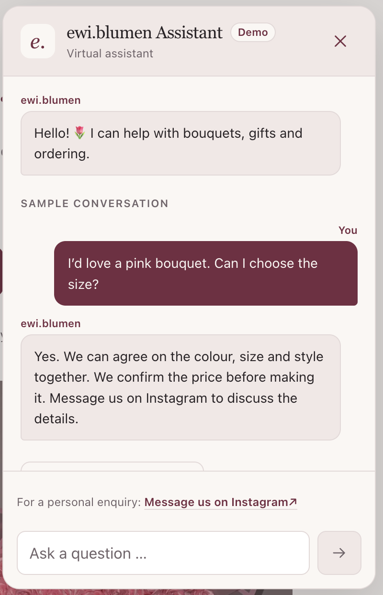

# ewi.blumen — AI-Assisted Handmade Flower Shop

A multilingual boutique flower-shop experience combining handmade product discovery, personalized ordering, and conversational guidance.

ewi.blumen brings a Stuttgart handmade flower brand beyond social media: visitors can explore previous work, plan a custom bouquet, and get guided toward a personal order request.

## Highlights

- Handmade bouquets and gift arrangements, presented in a responsive boutique storefront.
- German, English, Russian, and Ukrainian content throughout the shopping journey.
- Guided product discovery, customization advice, and clear ordering steps.
- Conversational assistant demo with suggested customer questions and an Instagram handoff.
- Mobile-first layouts and keyboard-accessible navigation, gallery, and chat controls.

## Website Experience

**Discover the brand.** A clear first impression pairs the handmade product with a direct enquiry route.

**Explore the work.** The gallery showcases decorative bouquets and gift arrangements.

**Plan a custom order.** The site explains the Instagram enquiry, design discussion, and Stuttgart collection steps.

**Continue the conversation.** A final call to action brings visitors to Instagram for a personal request.

## Conversational AI Assistant

The assistant experience helps visitors discover bouquet options, ask about colour and size, understand ordering, and move from browsing to a personal Instagram enquiry. Its interface follows the selected site language.

**Start with a question.** Suggested prompts make the first step easy.

**See the guidance.** A sample conversation shows how a bouquet request leads to customization and the Instagram handoff.

**Current demo scope:** The in-browser assistant uses curated replies for the suggested questions. Free-form messages receive a fallback directing visitors to Instagram; there is no connected AI model or automated order processing in this version.

## Product Concept

Social discovery → boutique website → product inspiration → guided questions → customization discussion → Instagram order request. The project connects storefront design and conversational customer experience into one journey.

## Multilingual & Responsive

The storefront and assistant support **DE / EN / RU / UK**, with layouts adapted for desktop and mobile.

## Tech Stack

React · Vite · JavaScript · CSS · responsive WebP product imagery · localized content · accessible conversational UI

## Project Structure

- `src/` — storefront, translations, styles, and assistant interface
- `public/` — optimized product imagery and favicon
- `images/` — project banner and screenshots for this showcase

To explore the source locally: `npm install`, then `npm run dev`. Use `npm run build` to create the production bundle.
